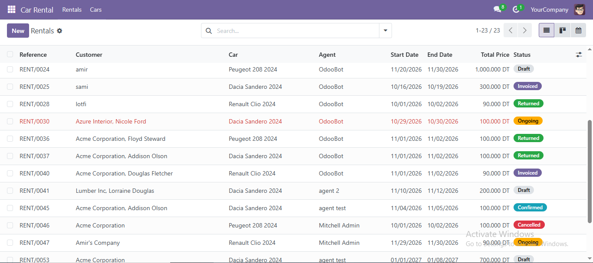
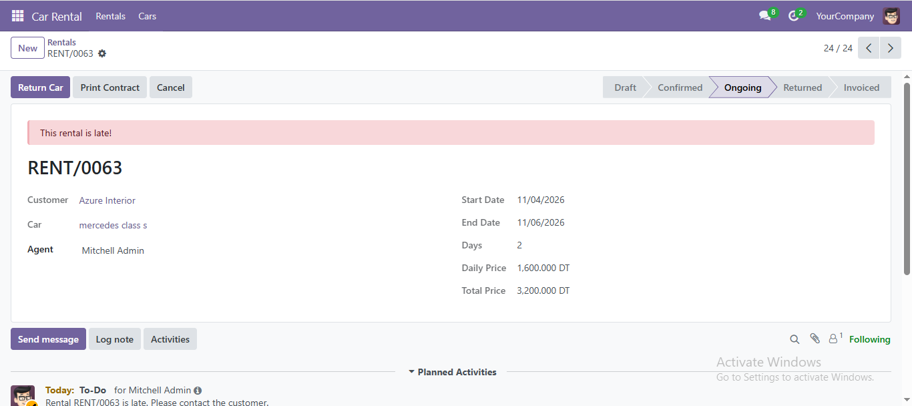
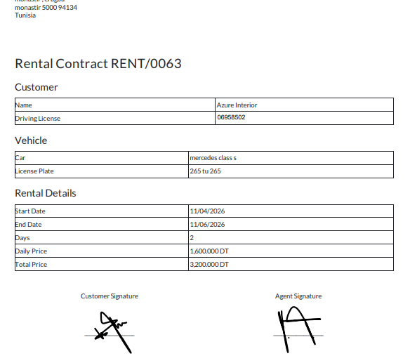
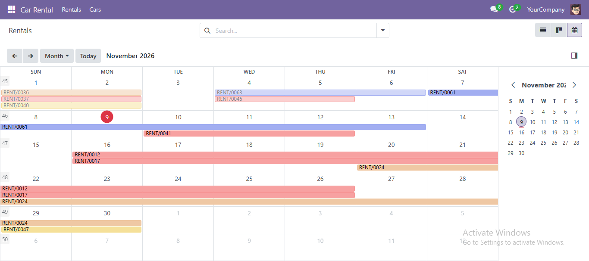

# 🚗 Car Rental Management for Odoo 18

A complete car rental module for Odoo 18: fleet, rentals, returns, invoicing and PDF contracts.
Built for small and medium car rental agencies.

## ✨ Features

- **Fleet management**: cars with status (available, rented, maintenance) and unique license plates
- **Rentals**: automatic duration and price calculation, overlap check (no double booking)
- **Workflow**: Draft → Confirmed → Ongoing → Returned → Invoiced, with full history (chatter)
- **Return wizard**: mileage and damage report when the car comes back
- **Late rentals**: daily automatic check, highlighted in red, with a reminder activity for the agent
- **Invoicing**: one-click customer invoice from a rental
- **PDF rental contract** with signature areas
- **Security**: Agent and Manager roles, each agent sees only their own rentals
- **Customer integration**: driving license on the contact form, rental count smart button
- **Public JSON API** of available cars, ready for a website

## 🖼️ Screenshots

### Rentals list



### Rental form



### PDF contract



### Calendar view



## 🛠️ Technical Stack

- Odoo 18 (Community)
- Python 3.10+
- PostgreSQL
- Dependencies: `base`, `mail`, `account`

## 📦 Installation

1. Copy the `car_rental` folder into your Odoo addons path.
2. Restart Odoo and update the apps list.
3. Install **Car Rental** from the Apps menu.
4. For PDF reports, install wkhtmltopdf 0.12.6 (with patched qt).

## ⚙️ Configuration

1. Go to **Settings → Users** and give each employee a **Car Rental** role: Agent or Manager.
2. Set your company currency and logo in **Settings → Companies**.
3. Add your cars in **Car Rental → Cars**.

## 🔌 API

`GET /api/cars/available` returns the available cars in JSON:

```json
[
  {
    "id": 1,
    "name": "Dacia Sandero 2024",
    "brand": "Dacia",
    "daily_price": 100,
    "currency": "TND"
  }
]
```

## 👤 Author

**Amir Miled**, Odoo Developer

- LinkedIn: https://www.linkedin.com/in/amir-miled/
- Email: miledamir8@gmail.com
